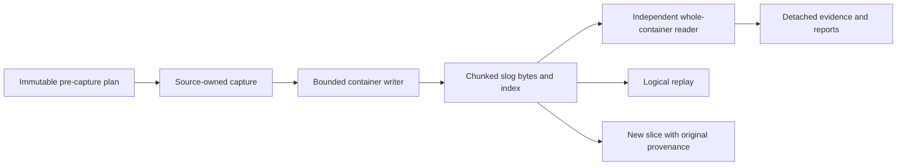
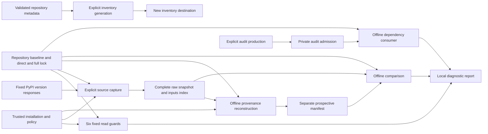

<!--
SPDX-License-Identifier: AGPL-3.0-or-later
Commercial license available
© Concepts 1996–2026 Miroslav Šotek. All rights reserved.
© Code 2020–2026 Miroslav Šotek. All rights reserved.
ORCID: 0009-0009-3560-0851
Contact: www.anulum.li | protoscience@anulum.li
SPIKE-LOG — source and configuration provenance
-->
# Record, replay and container boundaries

The plan precedes capture; a completed result references the plan and container later. A container never hashes itself or a future result. Detached evidence signing is consumed from EVIDENCE-MANIFEST-TOOLKIT, with actual class and qualification limits.

The canonical event shape retains signed integer ticks, geometry, polarity and stream identity. Original order is preserved; explicit unsorted sources remain labelled rather than silently sorted. Chunk counts, tick bounds, index byte offsets and the whole integrity chain are checked against actual bytes. Partial recovery is a new partial identity with visible gaps, never complete verification.

DVS columns and source-native APS/IMU/trigger/external bytes remain distinct. An external codec needs an actual selected parser before interpreted semantics can be accepted. In particular, neural state/spike/service bytes are not DVS pixels. Empty complete streams and missing streams are different states.

Planned production surfaces are record, replay, inspect, verify and slice. They are implemented together with their actual producer/consumer boundaries, strict checks, dedicated tests and corresponding documentation. The current source tree contains repository validation infrastructure under construction; planned runtime names do not imply available commands.

A timed event population and a typed metadata population have separate counts. A known auxiliary codec may carry nonempty metadata with zero timed records; that chunk and its index row retain null tick bounds. It uses a separate metadata hash domain with no signed tick fields. Timed chunks keep their existing framing and actual tick extrema. Both kinds contribute to the index, integrity chain and total chunk count. Slicing preserves or explicitly transforms required metadata through the selected codec, otherwise it refuses.

The `.slog` transport binds its exact ordered raw bytes, including real chunk offsets. Its enclosing evidence manifest references those raw bytes; signing applies to that manifest. Converting the container to a different JSON serialisation would change its identity. Earlier format-conversion layout and codec sources are explicit inputs; generic evidence validation does not establish their numerical or source semantics.

## Repository validation tooling

The container flow above is planned. Current repository tooling has separate
source, installed-producer and diagnostic flows:

Registry-source capture has a parent supervisor and fixed installed worker.
One finite budget covers its input/source checks, acquisition, publication,
readback and owned cleanup. Complete snapshots take the same supervised offline
validation path. The public capture-only budget control is described in the
[source workflow](docs/validation-tooling.md#prepare-a-complete-prospective-source-snapshot).

Inventory generation, audit production, registry-source capture and prospective
provenance generation are four explicit metadata-writing operations. The
offline comparison is a separate read operation. Normal verification does not
fetch replacement metadata, create a candidate or renew audit admission as a
repair fallback. Native checks still own their caches and build outputs.

Capture records the complete raw responses for the fixed development graph.
It publishes the index last and retains an incomplete directory on failure.
A complete existing snapshot is revalidated offline and kept unchanged.
Reconstruction reads that explicit snapshot and installed producer/licence
bytes, then publishes a new candidate without replacing the baseline.
A candidate's historical audit declaration is retained input, not a fresh
auditor result.

[The implemented component boundaries](docs/ARCHITECTURE.md#repository-validation)
describe command dispatch, data ownership and publication. These operations
provide repository tooling; they do not implement the planned event-stream
record/capture/replay surfaces or qualify their evidence.
